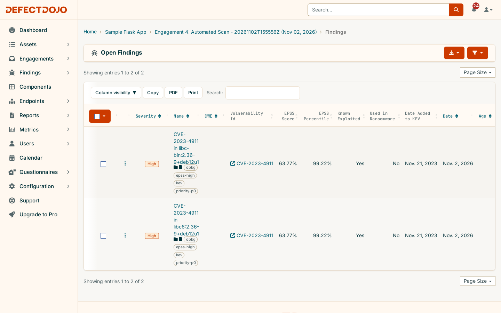

# DefectDojo — Local Deployment & SAST/DAST Pipeline POC

A proof-of-concept built end-to-end against a real, locally running [DefectDojo](https://github.com/DefectDojo/django-DefectDojo)
instance — the open-source ASPM/vulnerability-management platform used by AppSec teams to aggregate
findings across scanners and manage remediation. Every command and number documented in this repo was
actually run in the process of building it; nothing here is hypothetical.

**Start here:** [`docs/DEFECTDOJO.md`](docs/DEFECTDOJO.md) — what DefectDojo is, its data model, how it's
used, and why it's useful. The two parts below are the hands-on proof of each of those claims.

---

## Repo map

```
deployment/     Part 1 — stand up DefectDojo itself (Docker Compose) and prove the REST API works:
                product -> engagement -> scan import -> findings -> reimport/deduplication.

sample-app/     Part 2 — a minimal Flask app plus a local pipeline (Semgrep SAST + Grype SCA + OWASP ZAP
                DAST) that scans it, reports the results into the DefectDojo from Part 1, and triages
                CVE findings by real-world exploitability (EPSS + CISA KEV), automatically.

docs/           What DefectDojo actually is: data model, usage, integrations, value - how this
                same setup extends to tracking multiple projects at once - and EPSS/KEV triage.
```

### Part 1 — [`deployment/`](deployment/)

A pre-built-image Docker Compose stack (no DefectDojo source checkout needed), pinned to release
`3.4.304`. [`deployment/README.md`](deployment/README.md) walks through standing it up and driving the
full product/engagement/finding lifecycle by hand via `curl`, including a reimport that proves
deduplication actually works.

### Part 2 — [`sample-app/`](sample-app/)

A deliberately tiny Flask app used purely as a scan target, plus
[`scan-and-report.sh`](sample-app/scan-and-report.sh): runs Semgrep (SAST) and an OWASP ZAP baseline scan
(DAST) against it, plus an Anchore Grype scan (SCA) of its container image, then imports all three reports into the Part 1 DefectDojo instance via its API — a real
CI/CD-shaped pipeline (scan → report → import), run locally rather than on GitHub Actions because
DefectDojo here only exists on `localhost` and cloud runners can't reach it (see
[`sample-app/README.md`](sample-app/README.md) for why that tradeoff was made). One run of it produced 13
real findings (4 Semgrep, 9 ZAP) now sitting in DefectDojo. The Grype stage adds 195 CVE findings on the
current base image.

### EPSS / KEV triage — [`docs/EPSS-KEV-TRIAGE.md`](docs/EPSS-KEV-TRIAGE.md)

DefectDojo Community Edition has EPSS and CISA KEV fields on every finding, but only Pro keeps them
populated and turns them into a priority. [`sample-app/enrich-epss-kev.py`](sample-app/enrich-epss-kev.py)
closes that gap through the REST API. It refreshes EPSS (FIRST.org) and KEV (CISA) on every CVE finding and
tags it `priority-p0` (in KEV) through `priority-p3`, without touching severity. On a deliberately stale
base image (`BASE_IMAGE=python:3.11.5-slim-bookworm ./scan-and-report.sh`), **248 Critical/High findings
reduce to 13 actionable ones, 2 of them fix-now** (CVE-2023-4911 "Looney Tunables", actively exploited).



### Docs — [`docs/DEFECTDOJO.md`](docs/DEFECTDOJO.md)

The deep-dive: what DefectDojo is, its Product → Engagement → Test → Finding data model, how scan
import/reimport/deduplication actually work, its integration ecosystem, Community vs. Pro, and why any of
this is useful to an organization — each claim cross-linked to where it's demonstrated in this repo.

See also [`docs/EPSS-KEV-TRIAGE.md`](docs/EPSS-KEV-TRIAGE.md) for triaging findings by exploitation risk
(EPSS + CISA KEV) on Community Edition, and [`docs/MULTI-PROJECT-TRACKING.md`](docs/MULTI-PROJECT-TRACKING.md) for how this same setup
extends beyond one sample app: onboarding multiple projects onto one DefectDojo instance, what that
buys once more than one project is reporting in, and the constraints worth knowing before relying on it
for more than a POC.

---

## Quick start

```bash
git clone https://github.com/CarlosRiggio/DefectDojo.git
cd DefectDojo

# Part 1: bring up DefectDojo
cd deployment && cp .env.example .env   # fill in secrets, see deployment/README.md
docker compose up -d
cd ..

# Part 2: scan the sample app and report into it
cd sample-app && cp .env.example .env   # DD_PASSWORD from the initializer logs
./scan-and-report.sh
```
