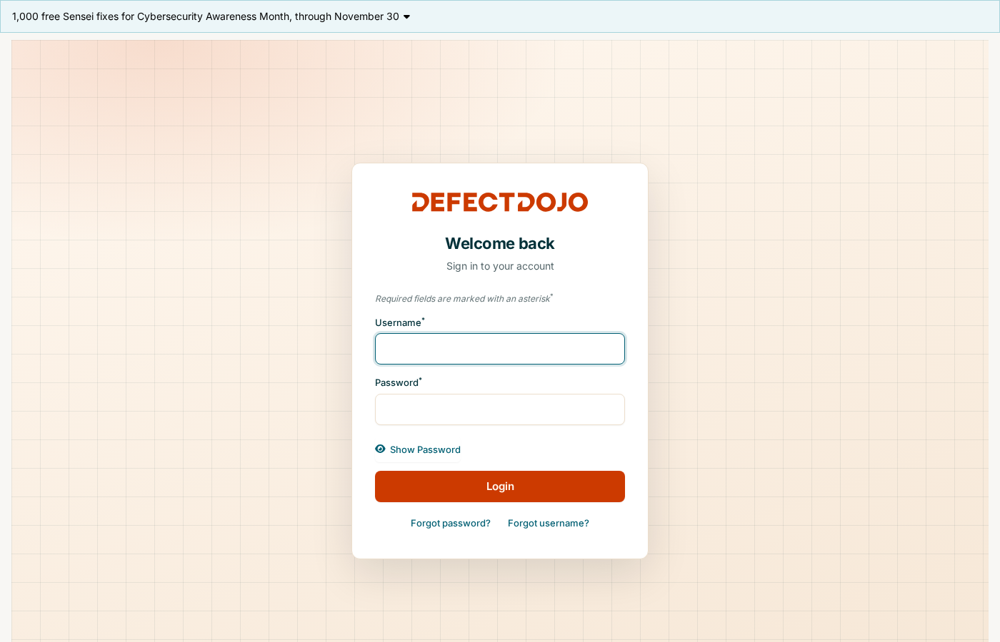
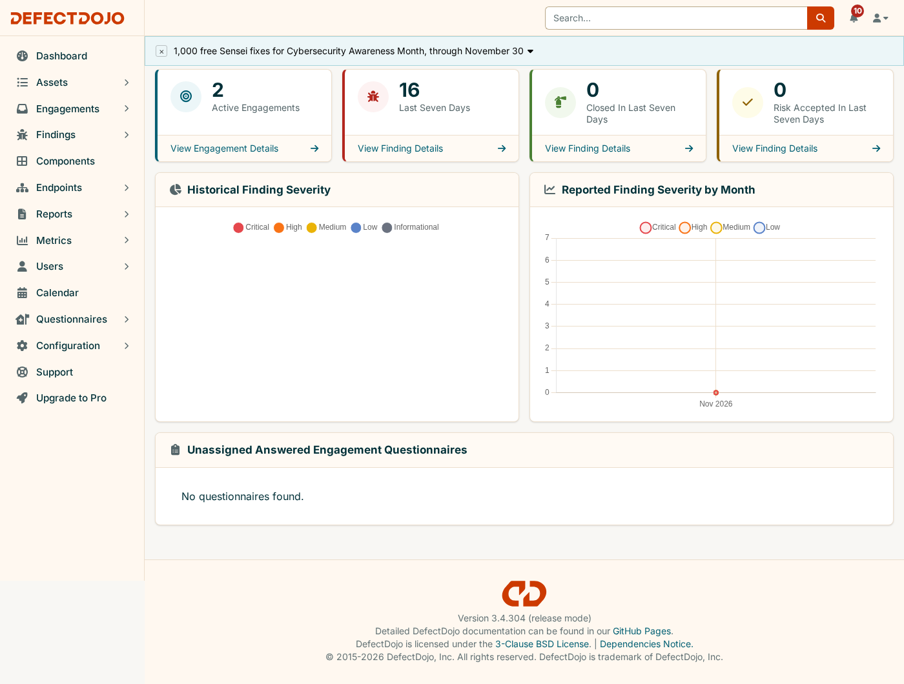
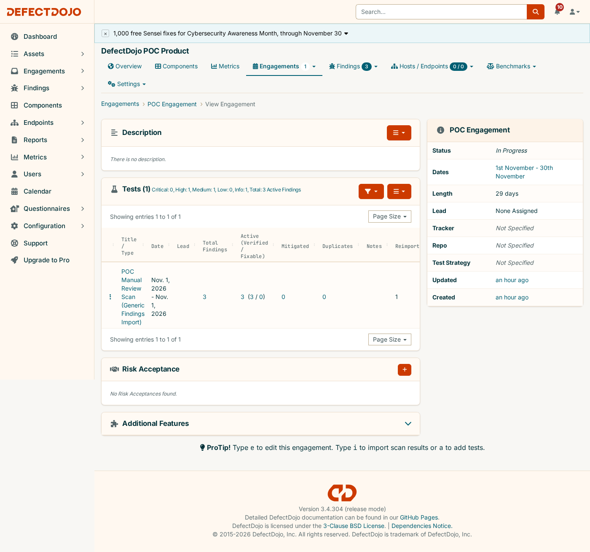
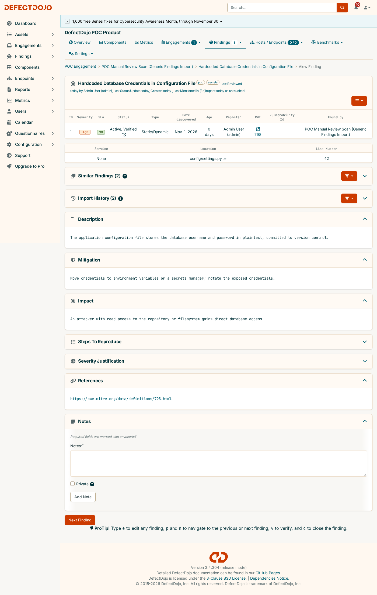

[← 1. Overview](01-defectdojo-overview.md) · **2. Deployment** · [3. Scan pipeline →](03-scan-pipeline.md)

# 2. Deployment

How the local DefectDojo instance is built, configured and started, then driven through its core
workflow over the REST API: authenticate → product → engagement → import → verify → reimport/dedup.

Everything was run against [`deployment/docker-compose.yml`](../deployment/docker-compose.yml). Command
output is real, with only secrets redacted.

- [Architecture](#architecture)
- [Configuration](#configuration)
- [Start the stack](#start-the-stack)
- [REST API walkthrough](#rest-api-walkthrough)
- [Stop and clean up](#stop-and-clean-up)

---

## Architecture

```
                        ┌──────────────┐
            :8080  ───▶ │    nginx     │
                        └──────┬───────┘
                               │
                        ┌──────▼───────┐        ┌──────────────┐
                        │    uwsgi     │◀──────▶│   postgres   │
                        │  (Django)    │        │   18.6-alpine│
                        └──────┬───────┘        └──────────────┘
                               │
                 ┌─────────────┼─────────────┐
          ┌──────▼──────┐ ┌────▼───────┐ ┌────▼────────┐
          │ celerybeat  │ │celeryworker│ │ initializer │
          │ (scheduler) │ │  (async)   │ │ (one-shot:  │
          └──────┬──────┘ └─────┬──────┘ │ migrations +│
                 │               │         │ admin boot) │
                 └───────┬───────┘         └─────────────┘
                 ┌────────▼────────┐
                 │     valkey      │  (Redis-compatible broker/cache)
                 │   9.1.2-alpine  │
                 └─────────────────┘
```

Seven services, the same topology as DefectDojo's
[upstream compose file](https://github.com/DefectDojo/django-DefectDojo/blob/master/docker-compose.yml)
but with `build:` removed. `nginx` and `uwsgi` pull pre-built images, so no application source checkout
is needed. Image versions are **pinned** for reproducibility:

| Component | Image | Version |
|---|---|---|
| Django / uwsgi | `defectdojo/defectdojo-django` | `3.4.304` |
| nginx | `defectdojo/defectdojo-nginx` | `3.4.304` |
| Database | `postgres` | `18.6-alpine` |
| Broker/cache | `valkey/valkey` | `9.1.2-alpine` |

## Configuration

All settings live in `deployment/.env`, created from the documented template
[`deployment/.env.example`](../deployment/.env.example). The file is git-ignored.

| Setting | Purpose |
|---|---|
| `COMPOSE_PROJECT_NAME=defectdojo` | Fixed, so container names (`defectdojo-uwsgi-1`, ...) don't depend on the directory name |
| `DJANGO_VERSION`, `NGINX_VERSION` | Image pins |
| `DD_IMAGE_REGISTRY` | Defaults to DefectDojo's pull-through registry; set `docker.io` to pull from Docker Hub |
| `DD_PORT` | Host port of the UI/API (`8080`) |
| `DD_DATABASE_*`, `DD_DATABASE_URL` | Postgres credentials. The URL must repeat the same password |
| `DD_SECRET_KEY`, `DD_CREDENTIAL_AES_256_KEY` | Django secrets |
| `DD_ADMIN_*` | Bootstrap admin user. The password **cannot** be set here: upstream generates it on first boot |

`make up` creates `deployment/.env` automatically ([`scripts/init-env.py`](../scripts/init-env.py)): it
copies the template, replaces every `CHANGE_ME` with a freshly generated secret, and keeps the database
password consistent between `DD_DATABASE_PASSWORD` and `DD_DATABASE_URL`. An existing `.env` is never
overwritten.

## Start the stack

**Prerequisites:** Docker Engine ≥ 19.03 with Compose v2, `python3`, `curl`.

### With make (recommended)

```bash
make up         # create .env if missing, docker compose up -d, wait for the UI + initializer
make password   # Admin password: <redacted - unique per deployment>
make status     # container states
```

`make up` waits until `http://localhost:8080/login` answers and checks that the one-shot `initializer`
exited `0`. It then writes `sample-app/.env` with the admin password, ready for the
[scan pipeline](03-scan-pipeline.md).

### By hand

```bash
cd deployment
cp .env.example .env   # replace every CHANGE_ME, e.g. openssl rand -hex 24
docker compose up -d
```

```bash
$ docker compose ps
NAME                        SERVICE        STATUS          PORTS
defectdojo-celerybeat-1     celerybeat     Up
defectdojo-celeryworker-1   celeryworker   Up
defectdojo-nginx-1          nginx          Up              0.0.0.0:8080->8080/tcp
defectdojo-postgres-1       postgres       Up
defectdojo-uwsgi-1          uwsgi          Up
defectdojo-valkey-1         valkey         Up
# defectdojo-initializer-1 is a one-shot job: it exits after bootstrapping

$ docker inspect defectdojo-initializer-1 --format '{{.State.Status}} exitcode={{.State.ExitCode}}'
exited exitcode=0

$ docker compose logs initializer | grep "Admin password:"
Admin password: <redacted - unique per deployment>

$ curl -sI http://localhost:8080/login
HTTP/1.1 200 OK
Server: nginx
Content-Type: text/html; charset=utf-8
```

### Log in

Open **http://localhost:8080** and log in as `admin`:





---

## REST API walkthrough

The full product → engagement → import → findings lifecycle, run with `curl` against `/api/v2/`.
DefectDojo's REST API is the same surface CI/CD pipelines use.

> This exact sequence is automated as `make test-smoke` ([guide 6](06-testing.md#live-make-test-smoke)),
> against a throwaway product it deletes afterwards.

### 1. Authenticate

```bash
curl -s -X POST http://localhost:8080/api/v2/api-token-auth/ \
  -H "Content-Type: application/json" \
  -d '{"username":"admin","password":"<admin password>"}'
```
```json
{"token":"<redacted>"}
```

### 2. Create a product

```bash
curl -s -X POST http://localhost:8080/api/v2/products/ \
  -H "Authorization: Token $TOKEN" -H "Content-Type: application/json" \
  -d '{"name":"DefectDojo POC Product","description":"Local Docker Compose POC deployment to demonstrate DefectDojo usage.","prod_type":1}'
```
→ `HTTP 201`, `id: 1`

### 3. Create an engagement under that product

```bash
curl -s -X POST http://localhost:8080/api/v2/engagements/ \
  -H "Authorization: Token $TOKEN" -H "Content-Type: application/json" \
  -d '{"name":"POC Engagement","product":1,"target_start":"2026-11-01","target_end":"2026-11-30","status":"In Progress","engagement_type":"Interactive"}'
```
→ `HTTP 201`, `id: 1`

### 4. Import findings

[`deployment/samples/generic-findings-sample.json`](../deployment/samples/generic-findings-sample.json) is
a hand-written report in DefectDojo's **Generic Findings Import** format, with 3 findings (High / Medium /
Info). It is used instead of real scanner output so the walkthrough is self-contained.

```bash
curl -s -X POST http://localhost:8080/api/v2/import-scan/ \
  -H "Authorization: Token $TOKEN" \
  -F "engagement=1" \
  -F "scan_type=Generic Findings Import" \
  -F "file=@deployment/samples/generic-findings-sample.json" \
  -F "active=true" -F "verified=true" -F "minimum_severity=Info"
```
→ `HTTP 201`, `test_id: 1`, with statistics matching the file:

```json
"statistics": {
  "after": {
    "info":   {"total": 1},
    "medium": {"total": 1},
    "high":   {"total": 1},
    "total":  {"total": 3}
  }
}
```

### 5. Verify the findings round-trip

```bash
curl -s "http://localhost:8080/api/v2/findings/?test=1" -H "Authorization: Token $TOKEN"
```
```
count: 3
- High   | Hardcoded Database Credentials in Configuration File
- Medium | Outdated Dependency With Known CVE
- Info   | Missing Security Headers on HTTP Responses
```

The engagement afterwards, and one finding's detail view. Severity, SLA countdown, CWE, description and
mitigation all came straight from the sample file:





### 6. Reimport to demonstrate deduplication

Posting the identical file to `/api/v2/reimport-scan/` against the same test returns a `delta` with all 3
findings `untouched` and 0 `created`. DefectDojo recognized them as already present instead of
duplicating them:

```json
"delta": {
  "created":   {"total": {"total": 0}},
  "untouched": {"total": {"total": 3}}
}
```

---

## Stop and clean up

| Command | Effect |
|---|---|
| `make down` | Stop the stack and keep all data (volumes) |
| `make up` | Start it again with the same data |
| `make clean CONFIRM=1` | **Delete everything**: containers and the postgres/media/redis volumes. Remove `sample-app/.env` afterwards, because the next boot generates a new admin password |

Equivalent by hand: `docker compose down` / `docker compose down -v` in `deployment/`.

---

[← 1. Overview](01-defectdojo-overview.md) · **2. Deployment** · [3. Scan pipeline →](03-scan-pipeline.md)
