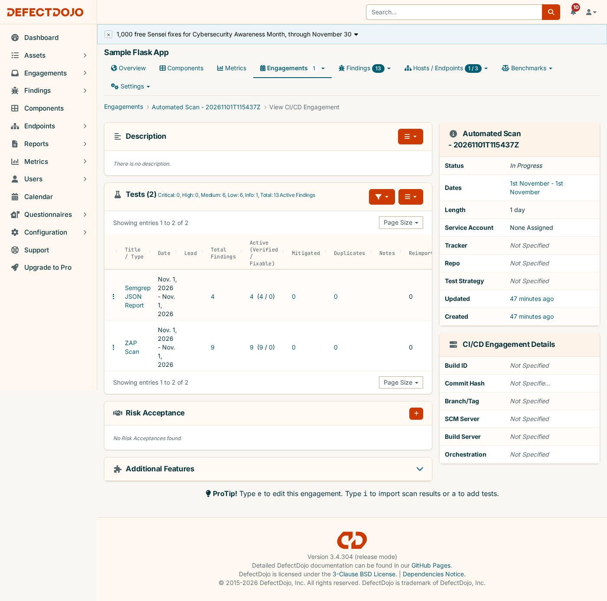
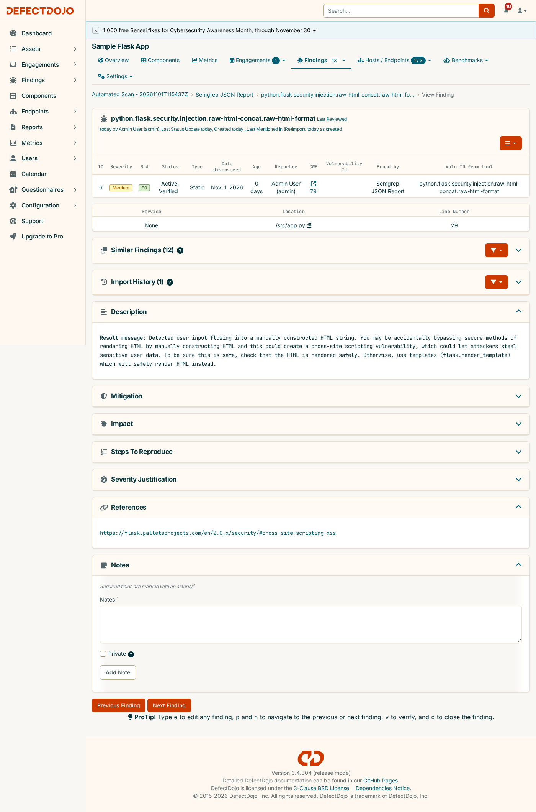
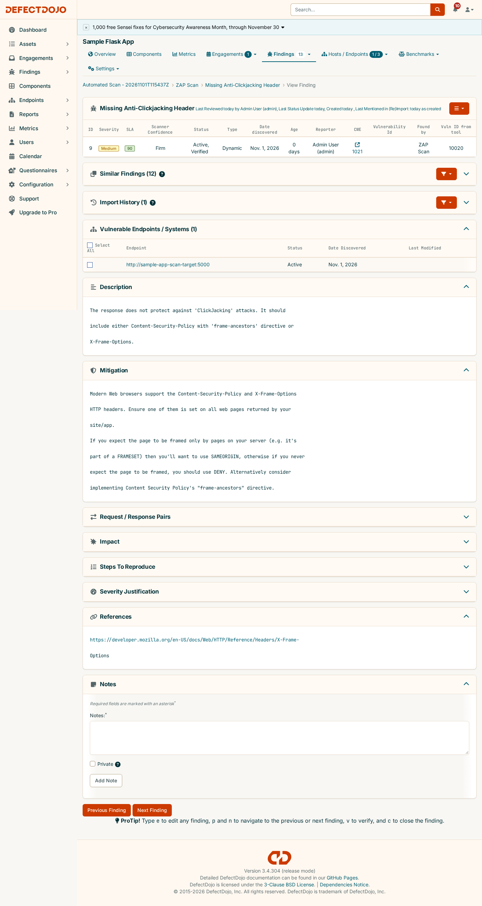
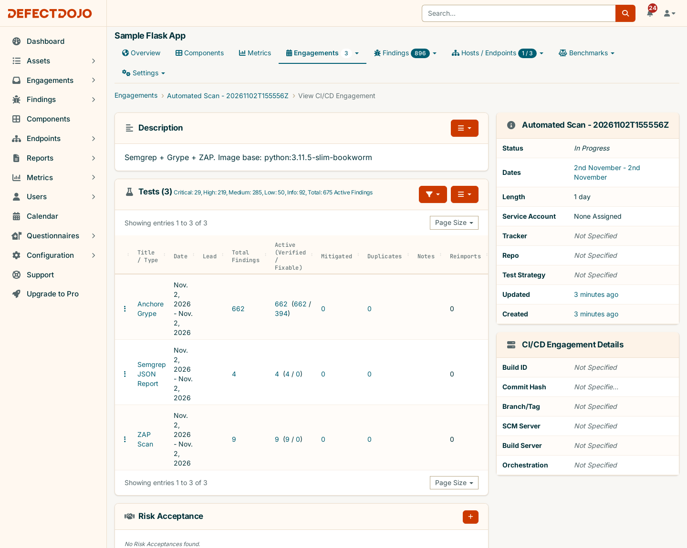

[← 2. Deployment](02-deployment.md) · **3. Scan pipeline** · [4. EPSS / KEV triage →](04-epss-kev-triage.md)

# 3. Scan Pipeline: Semgrep + Grype + ZAP → DefectDojo

A small Flask app ([`sample-app/app.py`](../sample-app/app.py)) used purely as a scan target, and
[`sample-app/scan-and-report.sh`](../sample-app/scan-and-report.sh), a CI-shaped pipeline that scans it
three ways, imports every report into the DefectDojo from [guide 2](02-deployment.md), and triages the
results.

- [Pipeline stages](#pipeline-stages)
- [Why a local script instead of GitHub Actions](#why-a-local-script-instead-of-github-actions)
- [Run it](#run-it)
- [What it found](#what-it-found)
- [Re-running](#re-running)
- [Files](#files)

---

## Pipeline stages

```
 app.py ──▶ 1. SAST   Semgrep ─────────────────────────┐
                                                       │
 Dockerfile ─▶ build image ─▶ 2. SCA   Grype ──────────┤  5. import-scan ×3   6. EPSS/KEV
                    │                                  ├─▶ into DefectDojo ──▶ triage
                    └─▶ 3. run ─▶ 4. DAST  OWASP ZAP ──┘   (1 engagement/run)  (priority tags)
```

| # | Stage | Tool (official Docker image) | Output → DefectDojo scan type |
|---|---|---|---|
| 1 | **SAST**: scans `app.py` with the `auto` ruleset | `semgrep/semgrep` | JSON → `Semgrep JSON Report` |
| 2 | **SCA**: builds the app image and scans its OS packages and Python deps. Includes EPSS and CISA KEV per CVE | `anchore/grype` | JSON → `Anchore Grype` |
| 3 | **Boot**: runs the image on a dedicated Docker network and polls `/health` until it answers | — | — |
| 4 | **DAST**: baseline scan against the running container | `zaproxy/zap-stable` | XML → `ZAP Scan` |
| 5 | **Report**: authenticates, finds or creates the `Sample Flask App` product, creates an `Automated Scan - <UTC timestamp>` engagement (its description records the base image), and imports all three reports | `curl` + REST API | — |
| 6 | **Triage**: [`enrich-epss-kev.py`](../sample-app/enrich-epss-kev.py) refreshes EPSS/KEV on every CVE finding of the product and tags `priority-p0..p3` | `python3` (stdlib) | PATCH findings |

Each stage prints its own `Checkpoint OK` (report exists and parses, app responds, import returned
`201`, enrichment summary), so a failure points at the stage that broke.

The app's `/greet` route **deliberately** reflects a query parameter into HTML without escaping, so the
scanners have something real to find. The base image can be overridden (`BASE_IMAGE`), so the same app
can be scanned on a current or a deliberately stale OS ([guide 4](04-epss-kev-triage.md)).

## Why a local script instead of GitHub Actions

DefectDojo here only exists at `localhost:8080`, and a cloud-hosted GitHub Actions runner cannot reach
that address. The alternative, a self-hosted runner registered to this repo, means workflow code runs
directly on your machine. That risk isn't worth taking for a POC. The script reproduces the same pipeline
*shape* a CI job would run (scan → report → import) where DefectDojo actually lives. A real rollout
changes this; see [guide 5](05-multi-project-tracking.md#constraints-to-carry-into-a-real-rollout).

## Run it

**Prerequisites:** the stack from [guide 2](02-deployment.md) up (`make up`), Docker, `python3`, and
outbound HTTPS to `cisa.gov` and `api.first.org` for the triage stage.

```bash
make scan                 # current base image (python:3.12-slim)
make scan-stale           # stale base image (python:3.11.5-slim-bookworm), exercises the KEV path
```

By hand, the same thing:

```bash
cd sample-app
cp .env.example .env      # set DD_PASSWORD (make up writes this file for you)
./scan-and-report.sh
BASE_IMAGE=python:3.11.5-slim-bookworm ./scan-and-report.sh
```

## What it found

### SAST + DAST (first run, engagement 2)

The first run, before the SCA and triage stages existed, captured as printed:

```
==> Running Semgrep (SAST) against sample-app source
Ran 290 rules on 1 file: 4 findings.
Checkpoint OK: semgrep-report.json valid JSON, 4 result(s)

==> Running OWASP ZAP baseline scan (DAST) against sample-app
WARN-NEW: Missing Anti-clickjacking Header [10020] x 1
WARN-NEW: X-Content-Type-Options Header Missing [10021] x 1
WARN-NEW: Server Leaks Version Information via "Server" HTTP Response Header Field [10036] x 3
WARN-NEW: Content Security Policy (CSP) Header Not Set [10038] x 3
WARN-NEW: Storable and Cacheable Content [10049] x 3
WARN-NEW: Permissions Policy Header Not Set [10063] x 3
WARN-NEW: Cross-Origin-Embedder-Policy Header Missing or Invalid [90004] x 3
FAIL-NEW: 0  WARN-NEW: 7  INFO: 0  PASS: 61
Checkpoint OK: zap-report.xml well-formed

==> Creating engagement for this run
Checkpoint OK: created engagement id=2 ('Automated Scan - 20261101T115437Z')
==> Importing Semgrep (SAST) results
Checkpoint OK: Semgrep import -> 4 finding(s) in DefectDojo
==> Importing ZAP (DAST) results
Checkpoint OK: ZAP import -> 9 finding(s) in DefectDojo
```

The 13 findings as they appear in DefectDojo (`GET /api/v2/findings/?test__engagement=2`):

| Severity | Finding | Source |
|---|---|---|
| Medium | `directly-returned-format-string`: raw f-string returned as a response | Semgrep |
| Medium | `raw-html-format` (Django rule, matched Flask's equivalent pattern) | Semgrep |
| Medium | `raw-html-concat`: unescaped string concatenated into an HTML response | Semgrep |
| Medium | `avoid_app_run_with_bad_host`: app bound to `0.0.0.0` | Semgrep |
| Medium | Content Security Policy (CSP) Header Not Set | ZAP |
| Medium | Missing Anti-Clickjacking Header | ZAP |
| Low | Cross-Origin-Embedder-Policy Header Missing or Invalid | ZAP |
| Low | Cross-Origin-Opener-Policy Header Missing or Invalid | ZAP |
| Low | Cross-Origin-Resource-Policy Header Missing or Invalid | ZAP |
| Low | Permissions Policy Header Not Set | ZAP |
| Low | Server Leaks Version Information via "Server" Header | ZAP |
| Low | X-Content-Type-Options Header Missing | ZAP |
| Info | Storable and Cacheable Content | ZAP |

Three of the Semgrep Mediums are exactly the deliberate `/greet` flaw.



The same severity scale, with two different kinds of location depending on the tool. Semgrep reports a
file and line; ZAP reports a URL endpoint:





### SCA + triage (engagements 3 and 4)

With Grype added, each run gets a third test. The pipeline was run once per base image:

| | `make scan` (`python:3.12-slim`) | `make scan-stale` (`python:3.11.5-slim-bookworm`) |
|---|---|---|
| Grype findings | 195 | 662 |
| Critical + High | 60 | 248 |
| `priority-p0` (CISA KEV) | 0 | **2** |
| `priority-p1` (high EPSS + High/Critical) | 0 | **11** |



The new stages from the stale-base run, as printed:

```
==> Building sample-app image (base: python:3.11.5-slim-bookworm)
Checkpoint OK: built sample-app:poc
==> Running Grype (SCA) against the sample-app container image
Checkpoint OK: grype-report.json valid JSON, 662 match(es), 2 in CISA KEV
...
==> Importing Grype (SCA) results
Checkpoint OK: Grype import -> 662 finding(s) in DefectDojo
==> Enriching product findings with EPSS + CISA KEV and tagging triage tiers
...
Tier summary: P0=2  P1=11  P2=298  P3=545
==> Done
Engagement: http://localhost:8080/engagement/4
Fix-now queue (CISA KEV):  http://localhost:8080/finding/open?tags=priority-p0
```

What those tiers mean, why only 13 of 248 Critical/High findings made the cut, and how it looks in the UI
are covered in [guide 4](04-epss-kev-triage.md).

## Re-running

The script reuses the `Sample Flask App` product and creates **one new engagement per run**, so repeated
runs simulate recurring CI scans landing in DefectDojo over time. The triage stage is idempotent: it only
PATCHes values that changed upstream.

## Files

| File | Purpose |
|---|---|
| [`app.py`](../sample-app/app.py) | The scan target: 3 routes, one deliberately reflecting input unescaped |
| [`requirements.txt`](../sample-app/requirements.txt), [`Dockerfile`](../sample-app/Dockerfile) | Build the target as a container (`BASE_IMAGE` build arg) |
| [`scan-and-report.sh`](../sample-app/scan-and-report.sh) | The pipeline: SAST → build + SCA → boot → DAST → import ×3 → triage |
| [`enrich-epss-kev.py`](../sample-app/enrich-epss-kev.py) | EPSS + CISA KEV enrichment and priority tags (standalone or cron) |
| [`.env.example`](../sample-app/.env.example) | `DD_URL` / `DD_USERNAME` / `DD_PASSWORD` template |

Generated reports (`semgrep-report.json`, `grype-report.json`, `zap-report.xml`) are git-ignored.

---

[← 2. Deployment](02-deployment.md) · **3. Scan pipeline** · [4. EPSS / KEV triage →](04-epss-kev-triage.md)
