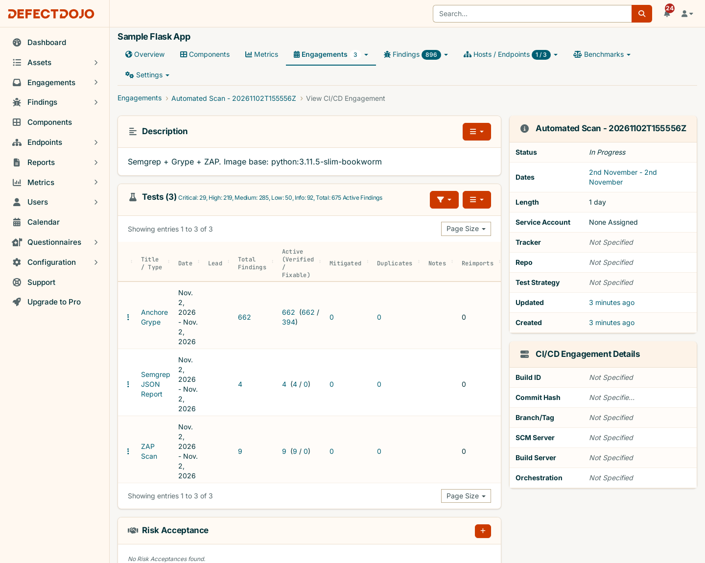
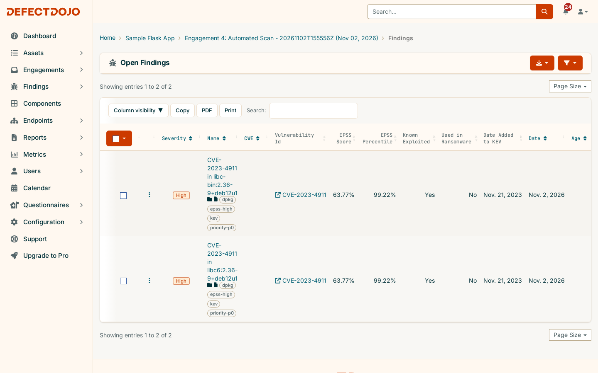
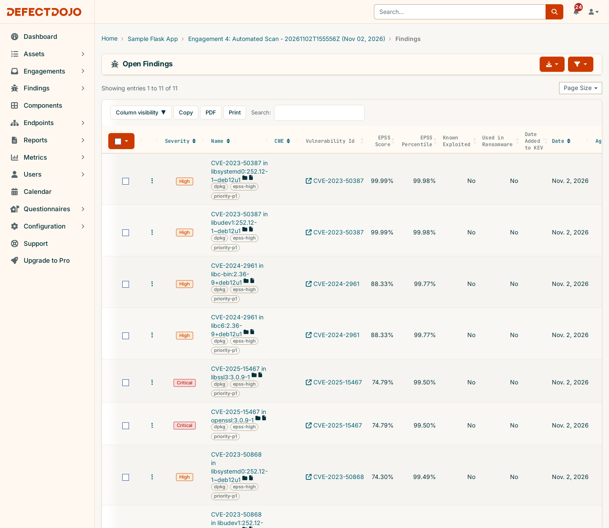
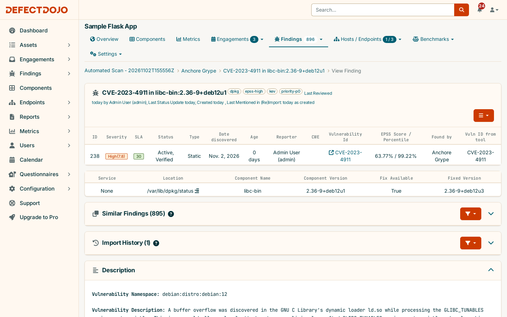

# EPSS + CISA KEV Triage on DefectDojo Community Edition

A scanner tells you *what* is vulnerable. It does not tell you *what to fix first*. This page covers how
this POC adds two threat-intelligence signals, **EPSS** and **CISA KEV**, to DefectDojo **Community
Edition** so findings can be triaged by real-world exploitation risk instead of severity alone. It also
shows what that did to real scan results.

Everything below was run against the local instance from [`../deployment/`](../deployment/). The numbers
come from the two pipeline runs on 2026-11-02 (engagements 3 and 4 of `Sample Flask App`).

---

## The three signals

| Signal | Question it answers | Scale | Source |
|---|---|---|---|
| **CVSS / Severity** | How bad *would* it be if exploited? | 0–10, static | NVD / vendor |
| **EPSS** | How *likely* is exploitation in the next 30 days? | 0.0–1.0 probability + percentile, refreshed daily | [FIRST.org](https://www.first.org/epss/) ML model |
| **CISA KEV** | Is it *being* exploited right now? | Yes/No + ransomware flag + due date | [CISA catalog](https://www.cisa.gov/known-exploited-vulnerabilities-catalog) (1,766 entries, catalog 2026.10.30) |

Severity measures impact. EPSS and KEV measure likelihood. Prioritizing on severity alone treats hundreds of
Highs as equally urgent, even though only a small fraction of CVEs are ever exploited. KEV is the
strongest signal, because exploitation has been confirmed. EPSS ranks everything that is not in KEV
(yet).

## What Community Edition has vs. what Pro adds

| Capability | Community (this POC) | Pro |
|---|---|---|
| Finding fields `epss_score`, `epss_percentile`, `known_exploited`, `ransomware_used`, `kev_date` | ✅ in the data model, writable via API | ✅ |
| EPSS/KEV columns + filters in the findings list | ✅ (see screenshots below) | ✅ |
| Parsers that fill the fields at import (Anchore Grype, Generic JSON/CSV, Dependency-Track, Snyk, ...) | ✅ | ✅ |
| **Automatic daily refresh** of EPSS/KEV for every finding | ❌ → **[`enrich-epss-kev.py`](../sample-app/enrich-epss-kev.py)** | ✅ |
| Priority / Risk score combining EPSS, KEV, severity, exposure | ❌ → **`priority-p0..p3` tags** | ✅ |
| SLA capped at CISA's KEV due date | ❌ (SLA is severity-based only) | ✅ |

So Community Edition is missing only two things, the **refresh** and the **prioritization**. This POC
adds both through the REST API, without patching DefectDojo itself.

## How it's wired into the pipeline

[`sample-app/scan-and-report.sh`](../sample-app/scan-and-report.sh) gained two stages:

1. **SCA with Anchore Grype.** It scans the built `sample-app:poc` container image (OS packages and Python
   deps). This matters because **EPSS and KEV only apply to findings with a CVE**. The existing Semgrep
   (SAST) and ZAP (DAST) findings are CWE-type weaknesses and can never be enriched. Grype's JSON already
   carries `epss` and `knownExploited` blocks per match, and DefectDojo's `Anchore Grype` parser maps
   them onto the finding at import.
2. **Enrichment + triage with [`enrich-epss-kev.py`](../sample-app/enrich-epss-kev.py)**, run on the
   product after every import (stdlib-only Python, no pip install):
   - pulls every active finding of the product and collects its CVE IDs
   - downloads the CISA KEV JSON feed and queries the FIRST EPSS API in batches of 100
   - for multi-CVE findings it applies Pro's rule: highest EPSS score paired with that CVE's percentile;
     KEV/ransomware if *any* CVE qualifies; earliest KEV date
   - PATCHes only what changed (it also clears stale KEV values) and maintains the triage tags.
     **Severity is never modified.**

### Triage tiers

| Tag | Rule | Meaning |
|---|---|---|
| `priority-p0` | In CISA KEV | Exploited in the wild: fix now |
| `priority-p1` | EPSS ≥ 10% **and** severity High/Critical | Likely to be exploited and impactful: next sprint |
| `priority-p2` | EPSS ≥ 10% **or** severity High/Critical | Planned remediation |
| `priority-p3` | Everything else with a CVE | Backlog / opportunistic |

Signal tags: `kev`, `kev-ransomware`, `epss-high`. The EPSS threshold is `--epss-threshold` (default
`0.1`). The script only manages these seven tags, so any tags a parser or a human added are preserved.

## What it did to real scan results

The same app, scanned twice. The only difference is the container's base image:

| | Run 1: `python:3.12-slim` (current) | Run 2: `python:3.11.5-slim-bookworm` (stale, Aug 2023) |
|---|---|---|
| Grype findings | 195 | 662 |
| Critical + High | 60 | 248 |
| In CISA KEV (**P0**) | **0** | **2** |
| High EPSS + High/Critical (**P1**) | **0** | **11** |
| P2 / P3 | 60 / 135 | 238 / 410 |
| Highest EPSS among Highs | 0.63% | 99.99% |

Run with `BASE_IMAGE=python:3.11.5-slim-bookworm ./scan-and-report.sh`

- **Run 1:** 60 High findings, and none of them is likely to be exploited. Without EPSS/KEV, those 60
  Highs look like a crisis. With it, the real answer is "patch on the normal SLA".
- **Run 2:** 248 Critical/High findings reduce to **13 actionable ones**, and **2 are fix-now**:
  CVE-2023-4911 ("Looney Tunables", glibc `ld.so` privilege escalation), on KEV since 2023-11-21 with an
  EPSS of 63.77% (99th percentile). Meanwhile 27 of the 29 *Critical* findings did **not** make P1, because their
  EPSS is low. One of them, CVE-2024-5535 in OpenSSL, sits at 5.58%.

The stale base image is deliberate, like the unescaped `/greet` route in `app.py`. "Someone pinned the
base image two years ago and nobody bumped it" is one of the most common real-world sources of KEV hits
in containers.

Run 2's enrichment output (excerpt):

```
Active findings: 896 (856 with a CVE, 404 distinct CVEs; findings without a CVE cannot be enriched)
CISA KEV catalog 2026.10.30: 1766 entries | EPSS scores returned for 404/404 CVEs

Top 20 of 856 CVE-bearing findings, most urgent first:
Tier    ID  Severity    EPSS   Pctl  KEV Ransom CVE(s) / title
P0     238  High      63.77%   0.99  yes no     CVE-2023-4911 - CVE-2023-4911 in libc-bin:2.36-9+deb12u1  [CISA due 2023-12-12]
P0     239  High      63.77%   0.99  yes no     CVE-2023-4911 - CVE-2023-4911 in libc6:2.36-9+deb12u1  [CISA due 2023-12-12]
P1     240  High      99.99%   1.00  no  no     CVE-2023-50387 - CVE-2023-50387 in libsystemd0:252.12-1~deb12u1
P1     241  High      99.99%   1.00  no  no     CVE-2023-50387 - CVE-2023-50387 in libudev1:252.12-1~deb12u1
P1     244  High      88.33%   1.00  no  no     CVE-2024-2961 - CVE-2024-2961 in libc-bin:2.36-9+deb12u1
P1     245  High      88.33%   1.00  no  no     CVE-2024-2961 - CVE-2024-2961 in libc6:2.36-9+deb12u1
P1     242  Critical  74.79%   1.00  no  no     CVE-2025-15467 - CVE-2025-15467 in libssl3:3.0.9-1
P1     243  Critical  74.79%   1.00  no  no     CVE-2025-15467 - CVE-2025-15467 in openssl:3.0.9-1
...
Tier summary: P0=2  P1=11  P2=298  P3=545
Findings updated: 661 (unchanged: 195)
```

The tier summary covers the whole product, so it includes Run 1's 195 findings, which were still open.
A third run of the script with no new imports reported `Findings updated: 0 (unchanged: 856)`, which
shows it is idempotent and safe to schedule.

## In the DefectDojo UI

The stale-base engagement. Grype appears as a third test next to Semgrep and ZAP, and the engagement
description records which base image was scanned:



The fix-now queue, `Findings → Open Findings`, filtered by tag `priority-p0` (or equivalently by
*Known Exploited = Yes*): exactly the two Looney Tunables findings. Community Edition's findings list
shows EPSS Score, EPSS Percentile, Known Exploited, Used in Ransomware and Date Added to KEV as native
columns:



The P1 queue (`priority-p1`, sorted by EPSS): 11 High/Critical findings with EPSS from 66% to 99.99%,
out of 248 High/Critical in the scan:



A finding's detail page. The triage tags sit next to the title, and Community Edition shows EPSS
Score / Percentile in the header row. The KEV booleans are not shown on this page in Community
Edition; they are visible in the list columns and via the `kev` tag. Note also the **SLA of 30 days**:
Community's SLA is severity-driven and knows nothing about KEV, even though CISA's due date for this
CVE (2023-12-12) passed long ago. That is the gap the `priority-p0` tag covers.



Useful UI URLs:

| View | URL |
|---|---|
| Fix-now queue | `/finding/open?tags=priority-p0` |
| Same, by KEV field | `/finding/open?known_exploited=true` |
| Urgent queue sorted by EPSS | `/finding/open?tags=priority-p1&o=-epss_score` |

## Running the enrichment on its own

```bash
cd sample-app
set -a; source .env; set +a
python3 enrich-epss-kev.py --dry-run            # what would change, whole instance
python3 enrich-epss-kev.py --product-id 2       # one product
python3 enrich-epss-kev.py --epss-threshold 0.05 --top 0   # stricter, print every row
```

EPSS changes daily and KEV grows every week. CISA can also flip a CVE's ransomware flag from "Unknown"
to "Known" without announcing it. Values set at import time therefore go stale, and the enrichment should
run on a schedule, not only in CI. A daily cron entry, for example:

```cron
30 6 * * * cd /path/to/DefectDojo/sample-app && set -a && . ./.env && set +a && python3 enrich-epss-kev.py >> /tmp/epss-kev.log 2>&1
```

## Limitations

- **No CVE, no enrichment.** SAST, DAST, secrets and IaC findings (all 13 Semgrep/ZAP findings here)
  stay severity-triaged. Lookups are by CVE ID only; GHSA/vendor-only IDs are skipped.
- **Tags are not a score.** Pro's Priority (0–1150) also weighs asset criticality and exposure.
  The P0–P3 tiers here are a deliberately simple, explainable stand-in.
- **SLA is not KEV-aware in Community.** The `priority-p0` tag gives the queue, not an automatic deadline.
- **Being absent from KEV doesn't mean safe.** KEV only lists *confirmed* exploitation. That is why EPSS
  fills the gap.
- **External calls.** The script calls `cisa.gov` and `api.first.org` (public, no key). Air-gapped
  setups would need to mirror both feeds.
