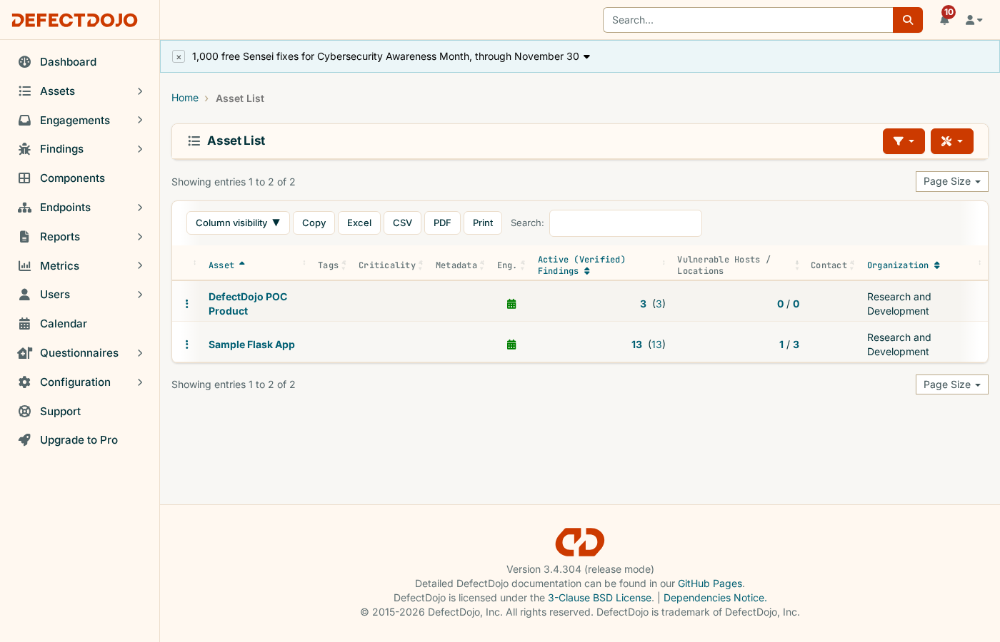
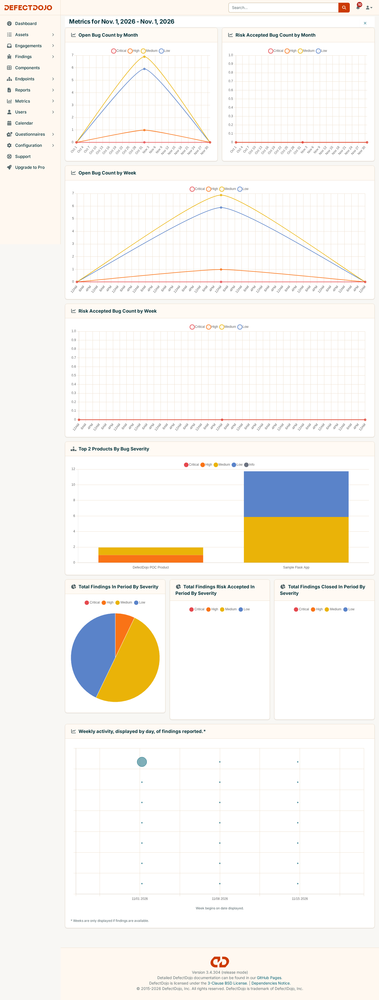

# Scaling this POC: tracking vulnerabilities across multiple projects

This repo proves the mechanics with one product (`deployment/`) and one sample pipeline (`sample-app/`).
The same mechanics scale to many projects without changing the model — only adding more Products to the
same DefectDojo instance. This doc covers how that extension would actually work and what it buys a team
that owns several projects.

## The idea in one sentence

One shared DefectDojo instance, one **Product** per project/repository, each project's own scanning
(existing or new) reporting into it through the exact `import-scan` / `reimport-scan` pattern already
proven end-to-end in [`sample-app/scan-and-report.sh`](../sample-app/scan-and-report.sh).

This is already visible with just the two products this repo created — `asset` here is this DefectDojo
build's UI label for what the API still calls a Product:

## Proposed model

- **Product Type** = a team or area; **Product** = one project/repo within it. A product type groups
  related products so dashboards and reports can roll up at the area level as well as per-project.
- **One Engagement per pipeline run**, same as this POC already does — so vulnerability history per
  project is just "look at the list of engagements for that product," ordered over time.
- The `scan-and-report.sh` pattern generalizes directly: product name, scan type(s), and target become
  parameters instead of hardcoded values, so the same script (or one per project, copied from this
  template) onboards any new project with the same scan → report → import shape.

## Onboarding a new project, step by step

1. **Create the Product** (via the API, the same call `scan-and-report.sh` already makes, or the UI).
2. **Point its existing scanner(s) at DefectDojo.** No new tooling is required if the project already
   runs something with a built-in parser (180+ supported: Trivy, Bandit, npm/pip audit, Checkmarx, Snyk,
   Nessus, etc.) — only the `import-scan` call needs adding to however that scan already runs. If it has
   no dedicated parser, the Generic Findings Import format covers it, same as `deployment/samples/` does
   here.
3. **Set an SLA configuration** if remediation deadlines should differ by project (a customer-facing
   service vs. an internal tool, for instance).
4. **Assign authorized users** on the product so each team sees and gets notified about its own project
   by default, rather than everyone seeing everything.
5. **Wire Jira/Slack (optional)** so findings land in whatever ticketing/chat each team already uses,
   instead of requiring everyone to log into DefectDojo directly.

## What changes once more than one project is reporting in

| Without this | With this |
|---|---|
| Each project's scanner has its own dashboard, severity scale, and report format | One normalized data model and severity scale across every project |
| Tracking remediation means checking N separate tools (or a spreadsheet) | One aggregated view of open findings by severity, across all products |
| Re-running a scan in CI either floods the backlog with duplicates or nobody re-imports at all | Reimport/deduplication (already demonstrated in `deployment/README.md`) keeps recurring CI scans clean at any number of projects |
| No consistent audit trail of what was found/accepted/fixed and when | Every finding, risk acceptance, and status change is timestamped and attributable, per project and rolled up |
| Onboarding a new project's security tracking means inventing a process each time | The same scan → report → import shape, already built once in `sample-app/`, is just reused |

The built-in metrics dashboard already aggregates across every product on the instance — "Top 2 Products By
Bug Severity" below is exactly this, generated automatically from the two products this repo created,
with zero extra configuration:

## Honest constraints to carry into any real rollout

- **Reachability**: this POC's local script (instead of real CI/CD) only works because DefectDojo lives
  on one machine. A multi-project rollout needs DefectDojo reachable from wherever each project's actual
  CI runs — either a deployed/reachable instance, or self-hosted runners with network access to it — plus
  real secret management for API tokens instead of a local `.env` file per project.
- **Auth at scale**: Community Edition uses local accounts, fine for a handful of people. Once several
  teams need access with different permissions, centralized auth (SSO/SAML/LDAP, a Pro feature) becomes
  the relevant question rather than a nice-to-have.
- **One shared instance is now a dependency**: it becomes something to secure, back up, and keep
  available for every project relying on it, not just a disposable local POC.
