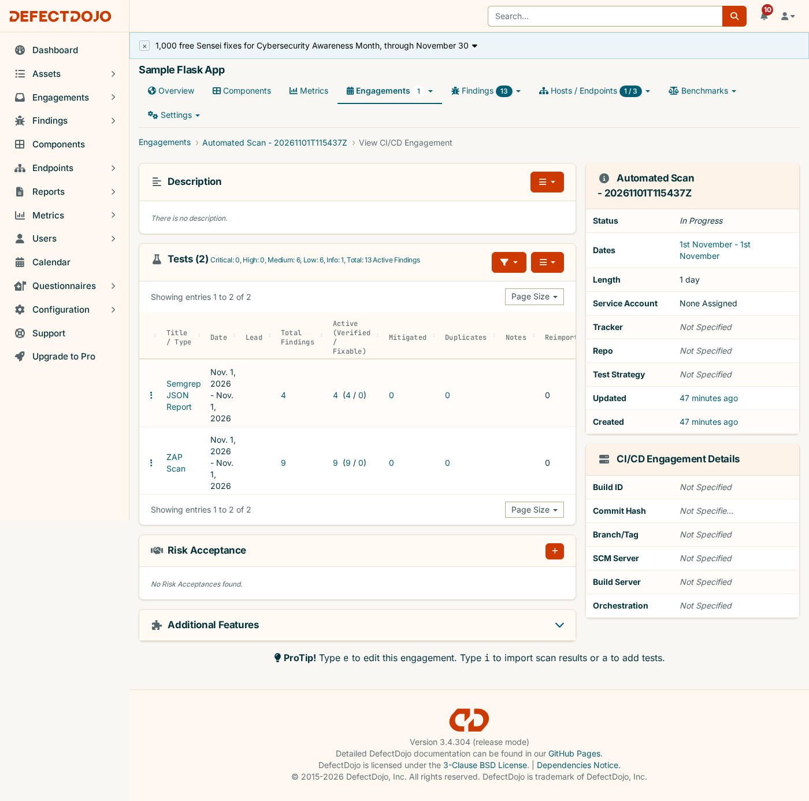
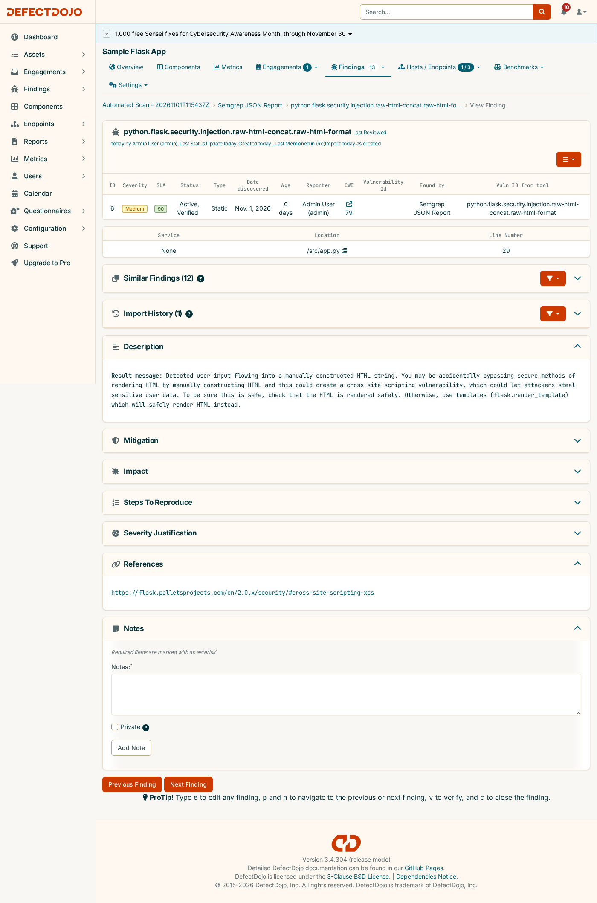
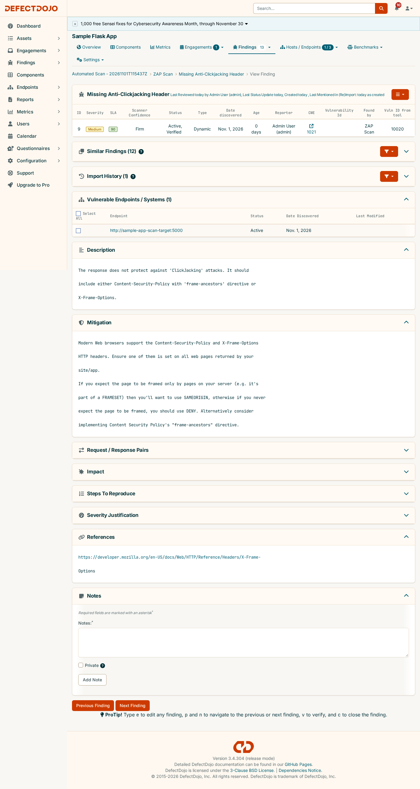

# Part 2 — Sample App + Local SAST/DAST → DefectDojo Pipeline

A minimal Flask app used purely as a scan target, plus [`scan-and-report.sh`](scan-and-report.sh): a local
pipeline that runs **Semgrep (SAST)** and **OWASP ZAP baseline (DAST)** against it and imports both
reports straight into the DefectDojo instance from [`../deployment/`](../deployment/) via its REST API.

### Why a local script instead of an actual GitHub Actions workflow

DefectDojo here only exists at `localhost:8080` on this machine. A cloud-hosted GitHub Actions runner
cannot reach that address, and the alternative (a self-hosted runner registered to this repo) means
arbitrary workflow code executes directly on your machine — a real risk that isn't worth taking for a
POC. So this reproduces the exact same pipeline *shape* a CI job would run (scan → report → import) as a
script you run locally, where "local" is also where DefectDojo actually lives. No exposed infra, no
runner to babysit, same result.

---

## Prerequisites

- Docker (used to run Semgrep, ZAP, and the sample app itself — no local pip/semgrep/zap install needed)
- The [`../deployment/`](../deployment/) DefectDojo stack already up (`docker compose up -d` there)

## Setup

```bash
cd sample-app
cp .env.example .env
# DD_PASSWORD: retrieve with
#   docker compose -f ../deployment/docker-compose.yml logs initializer | grep "Admin password:"
```

## Run it

```bash
./scan-and-report.sh
```

The script, step by step:
1. **SAST** — `semgrep/semgrep` (official image) scans `app.py` with the `auto` ruleset, `--json` output.
2. **Boots the target** — builds the sample app image, runs it on a dedicated Docker network, polls
   `/health` until it actually responds.
3. **DAST** — `zaproxy/zap-stable` (official image) runs a baseline scan against the running container,
   XML report (the format DefectDojo's `ZAP Scan` parser requires).
4. **Reports** — authenticates to DefectDojo, finds-or-creates a `Sample Flask App` product, creates a
   fresh `Automated Scan - <UTC timestamp>` engagement, and imports both reports into it.

Each step prints its own checkpoint (file exists and parses, app responds, import returned `201`) rather
than only a final summary — if something breaks, the script tells you which stage.

---

## A real run (captured output)

```
==> Running Semgrep (SAST) against sample-app source
...
Ran 290 rules on 1 file: 4 findings.
Checkpoint OK: semgrep-report.json valid JSON, 4 result(s)

==> Building and starting sample-app container
Waiting for sample-app to respond on :5000/health ...
Checkpoint OK: sample-app healthy after 2s

==> Running OWASP ZAP baseline scan (DAST) against sample-app
...
WARN-NEW: Missing Anti-clickjacking Header [10020] x 1
WARN-NEW: X-Content-Type-Options Header Missing [10021] x 1
WARN-NEW: Server Leaks Version Information via "Server" HTTP Response Header Field [10036] x 3
WARN-NEW: Content Security Policy (CSP) Header Not Set [10038] x 3
WARN-NEW: Storable and Cacheable Content [10049] x 3
WARN-NEW: Permissions Policy Header Not Set [10063] x 3
WARN-NEW: Cross-Origin-Embedder-Policy Header Missing or Invalid [90004] x 3
FAIL-NEW: 0  WARN-NEW: 7  INFO: 0  PASS: 61
Checkpoint OK: zap-report.xml well-formed

==> Authenticating to DefectDojo at http://localhost:8080
Checkpoint OK: got API token

==> Looking up / creating product 'Sample Flask App'
Checkpoint OK: created product id=2

==> Creating engagement for this run
Checkpoint OK: created engagement id=2 ('Automated Scan - 20261101T115437Z')

==> Importing Semgrep (SAST) results
Checkpoint OK: Semgrep import -> 4 finding(s) in DefectDojo

==> Importing ZAP (DAST) results
Checkpoint OK: ZAP import -> 9 finding(s) in DefectDojo

==> Done
Engagement: http://localhost:8080/engagement/2
Semgrep findings imported: 4
ZAP findings imported:     9
```

All 13 findings as they actually appear in DefectDojo afterward (`GET /api/v2/findings/?test__engagement=2`):

| Severity | Finding | Source |
|---|---|---|
| Medium | `directly-returned-format-string` — raw f-string returned as a response | Semgrep |
| Medium | `raw-html-format` (Django rule, matched Flask's equivalent pattern) | Semgrep |
| Medium | `raw-html-concat` — unescaped string concatenated into an HTML response | Semgrep |
| Medium | `avoid_app_run_with_bad_host` — app bound to `0.0.0.0` | Semgrep |
| Medium | Content Security Policy (CSP) Header Not Set | ZAP |
| Medium | Missing Anti-Clickjacking Header | ZAP |
| Low | Cross-Origin-Embedder-Policy Header Missing or Invalid | ZAP |
| Low | Cross-Origin-Opener-Policy Header Missing or Invalid | ZAP |
| Low | Cross-Origin-Resource-Policy Header Missing or Invalid | ZAP |
| Low | Permissions Policy Header Not Set | ZAP |
| Low | Server Leaks Version Information via "Server" Header | ZAP |
| Low | X-Content-Type-Options Header Missing | ZAP |
| Info | Storable and Cacheable Content | ZAP |

The three Semgrep "Medium" findings on `raw-html-format`/`raw-html-concat`/`directly-returned-format-string`
are exactly what [`app.py`](app.py)'s `/greet` route was built to trigger: it reflects a query parameter
straight into an HTML response without escaping it. It's left in deliberately — the whole point of this
app is to give both scanners something real to find, not to be production code.

The engagement as it actually looks in DefectDojo — two Tests, one per tool, 4 and 9 findings respectively:



Two finding detail pages, deliberately shown side by side — same severity scale, two different kinds of
location data depending on where the finding actually came from:





## Re-running

The script is idempotent on the product (reuses `Sample Flask App` if it already exists) and creates one
new engagement per run, so you can run it repeatedly to simulate recurring CI scans landing in DefectDojo
over time.

## Files

| File | Purpose |
|---|---|
| `app.py` | The scan target — 3 routes, one deliberately reflecting input unescaped |
| `requirements.txt`, `Dockerfile` | Build the scan target as a container |
| `scan-and-report.sh` | The pipeline: SAST → boot target → DAST → import both into DefectDojo |
| `.env.example` | `DD_URL` / `DD_USERNAME` / `DD_PASSWORD` template |
